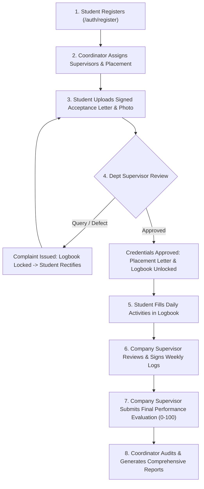

# SIWES Portal - Smart Industrial Training & Placement Management System

A modern, responsive, university-grade web application for managing the **Students Industrial Work Experience Scheme (SIWES)**. Built using a robust PHP MVC architecture, SQLite database, Tailwind CSS, and Alpine.js. Optimized for production hosting on **Nginx**, **Apache (XAMPP)**, or the PHP built-in development server.

---

## Table of Contents
1. [Overview & Architecture](#overview--architecture)
2. [Key Features & Recent Additions](#key-features--recent-additions)
   - [Two-Tier Supervisor Architecture](#1-two-tier-supervisor-architecture)
   - [Company Supervisor Dashboard](#2-company-supervisor-dashboard)
   - [Departmental Supervisor Dashboard](#3-departmental-supervisor-dashboard)
   - [Complaints & Query Management System](#4-complaints--query-management-system)
   - [Student Portal & Document Submission Flow](#5-student-portal--document-submission-flow)
   - [Dynamic Departments & Academic Levels Management](#6-dynamic-departments--academic-levels-management)
   - [Placement & Application Letter Customization](#7-placement--application-letter-customization)
   - [Intelligent Placement Allocation Engine](#8-intelligent-placement-allocation-engine)
   - [UI/UX, Responsiveness & Dark Mode](#9-uiux-responsiveness--dark-mode)
3. [End-to-End SIWES Workflow](#end-to-end-siwes-workflow)
4. [Default User Accounts & Credentials](#default-user-accounts--credentials)
5. [Installation & Setup Guide](#installation--setup-guide)
   - [Prerequisites](#prerequisites)
   - [Setup Steps](#setup-steps)
   - [Web Server Configuration](#web-server-configuration)
6. [Allocation Algorithm Scoring Matrix](#allocation-algorithm-scoring-matrix)
7. [Technology Stack](#technology-stack)

---

## Overview & Architecture

The SIWES Portal automates the entire lifecycle of industrial training for tertiary institutions—from student enrolment, supervisor allocation, company vetting, and document verification to weekly logbook submissions, supervisor grading, and final institutional reporting.

### Core Architecture
- **Model-View-Controller (MVC)**: Clean separation of concerns with PSR-4 autoloading.
- **Role-Based Access Control (RBAC)**: Strict permission enforcement across 5 distinct user roles:
  1. `admin` (System Administrator)
  2. `coordinator` (Institutional SIWES Coordinator)
  3. `officer` (Academic Department Officer)
  4. `supervisor` (Two subtypes: Departmental / Institution Supervisor & Corporate / Company Supervisor)
  5. `student` (Undergraduate SIWES Candidate)
- **Universal Asset & File Resolver**: Dynamic URL and file-streaming engine that supports Apache subfolders (`/siwes/public/`), Nginx root deployments, and local PHP CLI development seamlessly.

---

## Key Features & Recent Additions

### 1. Two-Tier Supervisor Architecture
The system supports a dual-supervision model reflecting real-world industrial attachments:
- **Departmental (Institution) Supervisor**: University faculty member assigned to verify student eligibility, scrutinize signed acceptance forms and passport photographs, issue departmental queries, and officially unlock student logbook privileges.
- **Company (Industry) Supervisor**: On-site industry mentor who supervises daily field duties, inspects weekly log entries, signs logbooks, and delivers performance evaluation sheets.

### 2. Company Supervisor Dashboard
- **Host Organization Branding**: The top of the dashboard prominently displays the supervisor's assigned company or host organization name with an official verification badge.
- **Assigned Interns Overview**: Real-time list of student interns attached to the company with matriculation numbers, phone contacts, and placement statuses.
- **Student Uploaded Documents Review Modal**: Clickable quick access to examine student credentials (Acceptance Letter, Passport Photo, and CV) with automatic cross-server link resolution.
- **Logbook Inspection & Signing**: View weekly progress reports submitted by interns, leave constructive feedback remarks, and verify completed training weeks.
- **Performance Evaluation Sheet**: Submit digital evaluation scoring (0–100), technical productivity notes, and institutional recommendations.

### 3. Departmental Supervisor Dashboard
- **Credential Verification Pipeline**: Centralized verification queue showing enrolled departmental students.
- **Logbook Gatekeeping**: Student daily logbooks and official placement letters remain strictly **locked** until the departmental supervisor verifies and approves the submitted credentials.
- **One-Click Approval**: Instantly approve credentials to unlock student access and issue official notifications.
- **Company Assignment & Reallocation**: Reassign corporate partners or partner mentors to students when required.

### 4. Complaints & Query Management System
- **Supervisory Query Engine**: Departmental supervisors and coordinators can file formal queries against students for irregular submissions.
- **Predefined Quick Templates**:
  - *Unclear Company Stamp*
  - *Incomplete Mentor / Supervisor Details*
  - *Mismatched / Unaccredited Host Firm*
  - *Passport Photograph Defect*
- **Instant Gatekeeping**: Issuing a complaint immediately sets the student's status to `Queried`, locks logbook access, and alerts the student to re-upload rectified documents.
- **Complaints Audit Table**: Track filed queries, view student explanations, and mark issues as resolved once rectified.

### 5. Student Portal & Document Submission Flow
- **Single-Submission Locking**: Students upload their signed Company Acceptance Letter and Passport Photograph. Once submitted, the portal locks the form to prevent unauthorized modifications while under review.
- **Assigned Supervisor Visibility**: Students can see their assigned Departmental Supervisor and Company Mentor alongside direct contact details.
- **Live Status Badges**: Real-time notification banners indicating whether documents are `Pending Review`, `Approved`, or `Queried`.
- **Placement & Application Letters**: Automatically unlocked once documents are approved. Students can download or print their introductory letters directly.
- **Interactive Weekly Logbooks**: Record daily technical activities, tools used, and challenges encountered, organized by training weeks.

### 6. Dynamic Departments & Academic Levels Management
- **Department Administration**: Admin and Coordinator can create, update, or remove academic departments without hardcoding restrictions.
- **Academic Levels Administration**: Configure study levels (e.g. 100 Level, 200 Level, 300 Level, 400 Level, 500 Level, ND I, HND II) with custom codes and year values.
- **Sign-Up Page Visibility Toggles**: Interactive switches in the management dashboard allow administrators to choose exactly which departments and academic levels appear on the public student registration page (`/auth/register`).
- **Dynamic Registration**: Prospective students select from only active, enabled departments and levels during sign-up.

### 7. Placement & Application Letter Customization
- **Institutional Placement Letter Editor**: Coordinators and administrators can modify official university introductory letter templates, signatures, and terms (`/coordinator/letters/placement`).
- **Company Application Letter Editor**: Host organizations can customize the format and requirements of their acceptance confirmation letters (`/coordinator/letters/company`).
- **Official Print Layouts**: Standardized print-ready formats featuring institutional letterheads, student details, and tear-off acceptance slips.

### 8. Intelligent Placement Allocation Engine
- **Automated Matching Matrix**: Scores students against corporate partners using specialized keyword matching, student choices (1st, 2nd, 3rd), geographical proximity coordinates, and company ratings.
- **Manual Overrides**: Coordinators can manually assign or lock placements at any time.
- **Batch Execution**: Execute automated batch allocation runs with live collision prevention and slot capacity limits.

### 9. UI/UX, Responsiveness & Dark Mode
- **Fully Responsive**: Optimized for mobile smartphones, tablets, and wide desktop screens with ergonomic touch targets and bottom padding.
- **Responsive Notification Modals**: Formatted notification viewer that fits mobile viewports without overflowing.
- **Dark Mode & Light Mode**: Persistent theme switcher with zero layout flickering.
- **Modern System Favicon**: Custom vector SVG and multi-size ICO favicons configured across all views.

---

## End-to-End SIWES Workflow



---

## Default User Accounts & Credentials

The portal is seeded with ready-to-test accounts across all roles:

| Role | Username | Password | Notes / Scope |
| :--- | :--- | :--- | :--- |
| **System Administrator** | `adminsiwes` | `admin123` | Full access: backups, system settings, departments & levels. |
| **SIWES Coordinator** | `coordinator` | `coord123` | User management, allocation engine, complaints, letter editors. |
| **Departmental Supervisor** | `dept_supervisor` | `super123` | Institutional supervisor: document approvals, complaints, queries. |
| **Company Supervisor** | `flutter_super` | `super123` | Flutterwave mentor: document review, logbook signing, evaluations. |
| **Company Supervisor** | `paystack_super` | `super123` | Paystack mentor: student supervision. |
| **Department Officer** | `officer_cs` | `officer123` | Computer Science department auditing. |
| **Student (Unallocated)** | `student1` | `student123` | New student testing registration & document upload. |
| **Student (Allocated)** | `student2` | `student123` | Allocated intern testing logbook entries. |

---

## Installation & Setup Guide

### Prerequisites
- **PHP 8.0 or higher**
- **SQLite3 & PDO_SQLite PHP extensions** enabled
- **Apache** (XAMPP), **Nginx**, or **PHP CLI server**

---

### Step 1: Clone or Copy Project
Place the project inside your web server directory:
```bash
# Example for XAMPP
cd C:\xampp\htdocs
git clone https://github.com/Gbest05/siwes.git
```

---

### Step 2: Enable SQLite in PHP
Open your active `php.ini` file (e.g. `C:\xampp\php\php.ini`) and ensure the following lines are uncommented:
```ini
extension=sqlite3
extension=pdo_sqlite
```
Save the file and restart Apache if running through XAMPP.

---

### Step 3: Run the Built-In Database Seeder (If Needed)
The repository includes a ready-to-use SQLite database at `app/Database/siwes.db`. If you ever need to reset or re-seed:
```bash
php -d extension=php_sqlite3.dll -d extension=php_pdo_sqlite.dll app/Database/db_init.php
```

---

### Step 4: Run the Application

#### Option A: PHP Built-in Server (Quickest for Development)
```bash
php -S localhost:8000 -t public public/index.php
```
Access in your browser at: **`http://localhost:8000/`**

#### Option B: XAMPP Apache
1. Start **Apache** from the XAMPP Control Panel.
2. Access in your browser at: **`http://localhost/siwes/public/`**

#### Option C: Nginx
Use the included `nginx.conf` virtual host configuration pointing root to the `public/` directory with `try_files $uri $uri/ /index.php?$query_string;`.

---

## Allocation Algorithm Scoring Matrix

When running the automated placement matcher, each candidate-company pair is evaluated:

$$\text{Final Score} = (\text{SpecMatch} \times 40) + \text{PreferenceScore} + \text{DistanceScore} + \text{RatingScore}$$

1. **Specialization Match ($\text{SpecMatch}$)** ($0$ or $40$ pts): $40$ points if the company's technical domain matches the student's field of study.
2. **Student Preferences ($\text{PreferenceScore}$)** ($0$ to $30$ pts):
   - $30$ points for 1st choice
   - $20$ points for 2nd choice
   - $10$ points for 3rd choice
3. **Geographical Distance ($\text{DistanceScore}$)** ($0$ to $20$ pts): Euclidean distance between university base coordinates and host firm coordinates:
   $$\text{DistanceScore} = \max\left(0, 20 - (\text{Distance} \times 15)\right)$$
4. **Company Star Rating ($\text{RatingScore}$)** ($0$ to $10$ pts): Verified mentor rating ($1$ to $5$ stars) $\times 2$.

---

## Technology Stack

- **Backend**: PHP 8.x (Custom MVC Framework, PSR-4 Autoloading)
- **Database**: SQLite3 with Foreign Keys & Transactional Integrity
- **Frontend**: Tailwind CSS, Alpine.js, FontAwesome 6 Icons
- **Typography**: Poppins & Inter Google Fonts
- **Server Support**: Nginx, Apache (`.htaccess`), PHP CLI Built-in Server

---

## License & Credits
Developed for academic institutions and SIWES industrial training directorates. Open-source under the MIT License.
